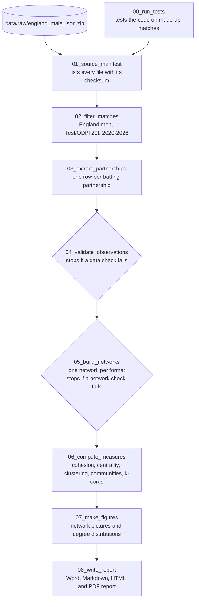

# How the project runs

This file shows the order in which our notebooks run and what each file is for.

Everything runs with one command from the project folder:

```bash
./run_pipeline.sh
```

The script runs the stage notebooks one after the other and stops at the first one that fails. Each stage
notebook first loads the library notebooks it needs (with `%run`), does its job and saves its results. The next
stage reads those saved files, so once the earlier stages have run, any single stage can be opened and re-run
on its own.

## Flow



The diamonds are stages with a stop rule: if one of their checks fails, the run stops there, so later stages
never work with wrong data.

## Stage notebooks (in running order)

| # | Notebook | What it does | Main outputs |
|---|---|---|---|
| 0 | `notebooks/00_run_tests.ipynb` | Tests every rule on small made-up matches where we know the right answer. Stops if any test fails. | test result table (inside the notebook) |
| 1 | `notebooks/01_source_manifest.ipynb` | Unzips the Cricsheet archive if needed and lists every file with its size and checksum. | `data/interim/source_manifest.csv`, `source_summary.json` |
| 2 | `notebooks/02_filter_matches.ipynb` | Keeps the matches in our study and writes one reason for every file left out. | `data/interim/file_audit.csv`, `data/processed/match_metadata.csv` |
| 3 | `notebooks/03_extract_partnerships.ipynb` | Reads every England innings ball by ball and writes one row per partnership. | `data/processed/partnership_observations.csv`, `innings_summary.csv`, `extraction_warnings.csv` |
| 4 | `notebooks/04_validate_observations.ipynb` | Checks the partnership table (structure and innings totals) and writes the data-quality report. | `docs/data_quality_report.md`, `outputs/tables/validation_*.csv`, `dataset_counts.csv` |
| 5 | `notebooks/05_build_networks.ipynb` | Builds the node and edge table of each format and checks them against the partnerships. | `data/processed/nodes_<format>.csv`, `edges_<format>.csv`, `players.csv` |
| 6 | `notebooks/06_compute_measures.ipynb` | Computes all measures for every batter and every network. | `outputs/tables/node_metrics_<format>.csv`, `network_summary.csv`, `communities_<format>.csv`, `core_sizes_<format>.csv` |
| 7 | `notebooks/07_make_figures.ipynb` | Draws the networks and the degree distributions. | `outputs/figures/*.png` |
| 8 | `notebooks/08_write_report.ipynb` | Holds the report text (one cell per section), fills in the numbers from the result tables, checks the word limit and builds the report files. | `report/report.docx`, `report.md`, `report.html` and the PDF |

## Library notebooks (loaded by the stages)

These only define settings and functions. Keeping them apart keeps the stage notebooks short and means no
function is written twice.

| Notebook | What is in it | Used by stages |
|---|---|---|
| `notebooks/library/lib_00_settings.ipynb` | All settings: folders, study dates, formats, random seed. Also the logger and the CSV helpers. | all |
| `notebooks/library/lib_01_data_loading.ipynb` | Unzipping, the source manifest, reading match files and the match filters. | 0, 1, 2, 3, 4 |
| `notebooks/library/lib_02_partnership_extraction.ipynb` | The ball-by-ball partnership extractor and its rules. | 0, 3 |
| `notebooks/library/lib_03_validation.ipynb` | The structural checks and the innings-total checks. | 4 |
| `notebooks/library/lib_04_network_building.ipynb` | Node, edge and player tables, the graph for each format and the network checks. | 0, 5, 6, 7 |
| `notebooks/library/lib_05_network_measures.ipynb` | All the measures: degree, strength, closeness, betweenness, eigenvector, clustering, redundancy, cohesion, small-world, k-cores and Louvain communities. | 0, 6 |
| `notebooks/library/lib_06_figures.ipynb` | The drawing style and the figure functions. | 7 |
| `notebooks/library/lib_07_report_writer.ipynb` | Turns the report text into Word (from the course template), Markdown and HTML, counts the words and prints the PDF. | 8 |

## Other files

| File | What it is for |
|---|---|
| `run_pipeline.sh` | Runs all stage notebooks in order and saves the package versions to `outputs/logs/environment.txt`. |
| `requirements.txt` | The package versions we used. |
| `report/authors.json` | Report title, author lines and the PDF file name. |
| `docs/methods_decisions.md` | Why we chose each measure and how it is computed. |
| `docs/data_quality_report.md` | Written by stage 4: the result of every data check. |
| `docs/reference/Network_Analysis_Project_Template.docx` | The course template the Word report is built on. |
| `outputs/logs/*.log` | What each stage did in its last run. |
