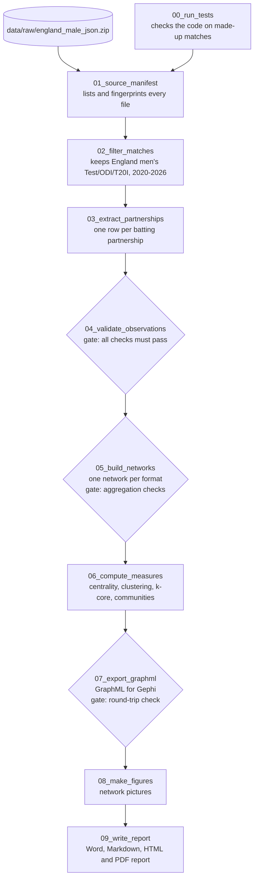

# Execution sequence

This file shows **the order in which the project runs** and **what each file does**.
Run everything with one command from the project folder:

```bash
./run_pipeline.sh
```

The script runs the stage notebooks below one after the other and stops at the first one that fails.
Each stage notebook first loads the library notebooks it needs (with `%run`), then does its job and saves
its results to disk. The next stage reads those saved files, so any stage can also be re-run on its own
once the stages before it have run.

## Flow



Diamonds are **gates**: the notebook stops with an error if a check fails, so later stages never run on bad data.

## Stage notebooks (run in this order)

| # | Notebook | What it is for | Main outputs |
|---|---|---|---|
| 0 | `notebooks/00_run_tests.ipynb` | Tests every rule on small made-up matches whose answers we know by hand (the 16 required cases plus the measure rules). Stops if any test fails. | test result table (in the notebook) |
| 1 | `notebooks/01_source_manifest.ipynb` | Unzips the Cricsheet archive if needed and records every file with its size and checksum, so the raw data can be identified later. | `data/interim/source_manifest.csv`, `source_summary.json` |
| 2 | `notebooks/02_filter_matches.ipynb` | Applies the study filters and gives every left-out file one written reason. | `data/interim/file_audit.csv`, `data/processed/match_metadata.csv` |
| 3 | `notebooks/03_extract_partnerships.ipynb` | Reads every England innings ball by ball and writes one row per partnership. This table is the audit trail of the whole project. | `data/processed/partnership_observations.csv`, `innings_summary.csv`, `extraction_warnings.csv` |
| 4 | `notebooks/04_validate_observations.ipynb` | Checks the partnership table three ways (structure, independent scorecard totals, famous partnerships) and writes the data-quality report. | `docs/data_quality_report.md`, `outputs/tables/validation_*.csv`, `dataset_counts.csv` |
| 5 | `notebooks/05_build_networks.ipynb` | Groups partnerships into a node table and an edge table per format and proves they match the observations exactly. | `data/processed/nodes_<format>.csv`, `edges_<format>.csv`, `players.csv` |
| 6 | `notebooks/06_compute_measures.ipynb` | Computes all node-level and network-level measures with the same rules for every format. | `outputs/tables/node_metrics_<format>.csv`, `network_summary.csv`, `communities_<format>.csv`, `core_sizes_<format>.csv` |
| 7 | `notebooks/07_export_graphml.ipynb` | Writes one GraphML file per format (with the measures attached) for Gephi and reads it back to check it. | `outputs/graphml/england_men_<format>.graphml` |
| 8 | `notebooks/08_make_figures.ipynb` | Draws the network figures from the GraphML files with one shared style. | `outputs/figures/*.png` |
| 9 | `notebooks/09_write_report.ipynb` | Holds the report text (one cell per template section), fills in every number from the output tables, checks the 5,000-word limit and builds the report files. | `report/report.docx`, `report.md`, `report.html`, PDF |

## Library notebooks (loaded by the stages, never run on their own)

They only **define** settings and functions. Keeping them separate means each stage notebook stays short and
the same function is never written twice.

| Notebook | What it holds | Used by stages |
|---|---|---|
| `notebooks/library/lib_00_settings.ipynb` | All settings in one place: folder paths, study dates, format names, random seed. Also the logger and the CSV read/write helpers. | all |
| `notebooks/library/lib_01_data_loading.ipynb` | Unzipping the archive, the source manifest, reading match files, the match filters. | 0, 1, 2, 3, 4 |
| `notebooks/library/lib_02_partnership_extraction.ipynb` | The ball-by-ball partnership extractor and its written rules. | 0, 3 |
| `notebooks/library/lib_03_validation.ipynb` | Structural checks, independent scorecard checks and spot checks. | 4 |
| `notebooks/library/lib_04_network_building.ipynb` | Node, edge and player tables, the NetworkX graph, aggregation checks, GraphML export and its round-trip check. | 0, 5, 6, 7 |
| `notebooks/library/lib_05_network_measures.ipynb` | Every network measure (degree, strength, betweenness, closeness, eigenvector, clustering, k-core, Louvain, redundancy, small-world). | 0, 6 |
| `notebooks/library/lib_06_figures.ipynb` | The shared drawing style and the three figure functions. | 8 |
| `notebooks/library/lib_07_report_writer.ipynb` | Turns the report text into Word (from the course template), Markdown and HTML, counts words and prints the PDF with Chrome. | 9 |

## Other files

| File | What it is for |
|---|---|
| `run_pipeline.sh` | Runs all stage notebooks in order with `jupyter nbconvert --execute --inplace`, then records package versions in `outputs/logs/environment.txt`. |
| `requirements.txt` | Exact package versions used. |
| `report/authors.json` | Report title, author lines and the PDF file name. |
| `docs/methods_decisions.md` | Why each measure was chosen and how it is computed. |
| `docs/data_quality_report.md` | Written by stage 4; the result of every data check. |
| `gephi/README.md` | Steps to open the GraphML files in Gephi with the same style. |
| `outputs/logs/*.log` | What each stage did in its latest run. |
