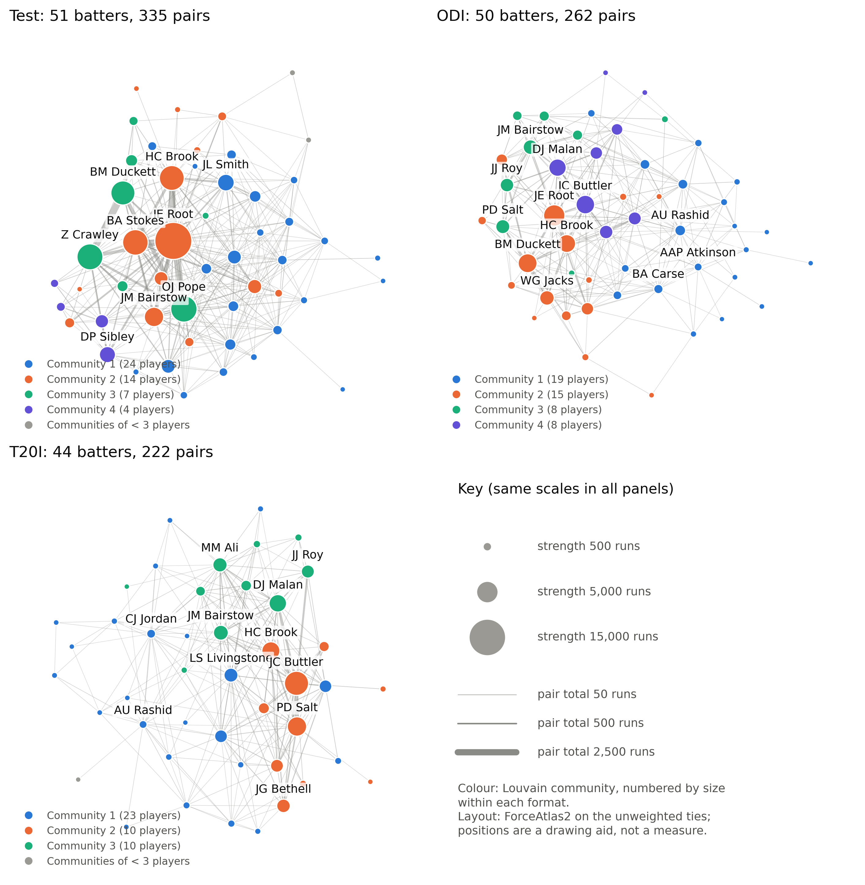
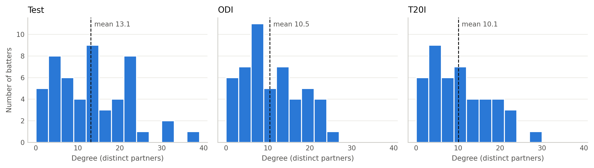

# The Partnership Effect: Batting-Partnership Networks of the England Men's Cricket Team in Test, ODI and T20I Cricket (2020-2026)

Hafiz Muhammad Mutahhir Khan, Degree Programme, ID number (matricola)  
Saidatta Nagesh Musale, Degree Programme, ID number (matricola)  
Mohamed Rizwan Roshan Raja Mohamed, Degree Programme, ID number (matricola)  
Saad Salman, Degree Programme, ID number (matricola)  

## Introduction

Network analysis looks at a system through the ties between its parts. Team sport is a natural fit for this view, and cricket batting has a very clear tie: the partnership. Two batters are always at the crease together and build the score as a pair. When a wicket falls, one of them is replaced and a new partnership starts. Over many matches these pairs form a network of who batted with whom, and how many runs they added together.

In this project we study the batting partnerships of the England men's team from 03 January 2020 to 29 October 2026. England play three international formats: Test matches (up to five days, two innings per side), One Day Internationals (ODIs, 50 overs per side) and Twenty20 Internationals (T20Is, 20 overs per side). Since the formats are played differently and often by different players, we build one network for each format and analyse all three in the same way. The networks show how widely each batter is connected, where the runs are concentrated, which groups of batters often bat together and who links these groups.

## Problem and Motivation

Cricket statistics usually describe single players, for example batting averages, or single partnerships, for example record stands. We wanted to see the whole batting group at once. A batting order is not a fixed set of pairs: openers meet the middle order, the middle order meets the tail, and players come and go over the years. Looking at the structure of these ties shows how much a batting side relies on a small core, how the top order and the tail are linked, and which players connect different parts of the squad. Using the same design on three formats also lets us compare them directly.

Research questions. We ask seven questions, one for each part of the analysis.

RQ1. What does each network look like overall, and how cohesive is it?

RQ2. Which batters are the most central?

RQ3. How clustered are the partnerships, and how redundant are a batter's ties?

RQ4. Which batters have the highest weighted degree, that is, the most partnership runs?

RQ5. Which communities of batters can we find?

RQ6. Which batters act as bridges (betweenness centrality)?

RQ7. Is there a core of batters with a periphery around it?

Our contribution is a step-by-step method that rebuilds every partnership from ball-by-ball data, three weighted partnership networks (one per format), and a side-by-side comparison of the three networks using the same set of measures.

## Datasets

Source. We used the public ball-by-ball data from Cricsheet (cricsheet.org), in the file england_male_json.zip. It holds 961 matches played by England men's teams, one JSON file per match (Cricsheet format version 1.3.0). The data is already digital, so nothing had to be typed in by hand. We keep the zip file unchanged in our project folder, together with a list of all its files and their checksums.

Boundary of the study. We set the boundary of the network with clear, formal rules (a nominalist approach). A match is part of the study if it is a men's international match, England is playing, the format is Test, ODI or T20I, and its first day falls between 1 January 2020 and 29 October 2026. 287 of the 961 matches meet these rules. The others were all played before 2020. In 7 limited-overs matches England did not get to bat, so these matches add no partnerships. Table 1 shows the data we worked with.

**Table 1. The data used in the study (England batting innings only).**

|  | Test | ODI | T20I | Total |
|---|---|---|---|---|
| Matches | 81 | 88 | 118 | 287 |
| England innings | 151 | 85 | 114 | 350 |
| Balls (deliveries) | 66,829 | 22,766 | 12,878 | 102,473 |
| Partnerships | 1,357 | 708 | 763 | 2,828 |
| Partnership runs | 43,080 | 22,929 | 18,974 | 84,983 |
| Nodes (batters) | 51 | 50 | 44 | 73 different |
| Edges (pairs) | 335 | 262 | 222 | - |

Finding the partnerships. For every England innings we read the balls in order. Each ball names the striker and the non-striker, gives the runs (runs.total, which already includes extras such as wides and no-balls) and lists any wicket. Our code remembers the current pair and adds the runs of each ball to it once. When a wicket record names one of the two batters, the partnership ends after that ball, so the runs scored on the wicket ball still go to the pair that was batting. The last partnership ends with the innings. If two batters are split up and later bat together again, for example after a retired-hurt batter comes back, we count two partnerships. In total we found 2,828 partnerships.

The network model. For each format we built one undirected, weighted (valued) and one-mode (monomodal) network. A node is a batter. An edge joins two batters who shared at least one partnership. The edge weight is the total number of runs the pair added together across all their partnerships in that format. Only batters who actually shared the crease become nodes. Across the three formats there are 73 different batters, and 26 of them appear in all three networks.

Tools. We handled the data in Python with pandas, computed the network measures with the NetworkX library and drew the figures with Matplotlib. All the work is organised as Jupyter notebooks that run in a fixed order, from the raw zip file to this report.

## Validity and Reliability

Validity. We want to measure who batted with whom and how many runs each pair added. Our ties are not guessed from other information: a tie exists only when Cricsheet records two batters at the crease together on at least one ball. This keeps edge attribution errors out of the model. To avoid omission errors, we read every ball of every England innings inside the boundary, and every one of the 961 files could be read. To avoid commission errors, only batters who actually shared a partnership became nodes. Players who were only in the squad, and the batting of the other team, are not part of the networks. The edge weight follows the usual cricket meaning of a partnership: the total the team added while the two batters were together, extras included. Penalty runs that are given to a whole innings and not to a single ball are not given to any pair. Players are identified by their fixed Cricsheet ID, so the same player is always the same node, and two different players never share one.

Reliability. The study is built on objective public records and every measure comes from a formula or an algorithm, so another group starting from the same zip file would get the same networks and the same numbers. The rules for building the data are written down and fixed in advance: the same boundary for every match, one network per format, and edge weights that are always the sum of the partnership runs. The one step that uses random numbers, Louvain community detection (and the random graphs we compare against), runs with a fixed seed. Because Cricsheet is a secondary source, we also checked that the files are consistent with themselves. All files use the same format version. In all 350 innings the partnership runs add up exactly to the runs of all the balls (84,983 runs from 102,473 balls). Adding up each innings straight from the balls also gives exactly the target and the winning margin stored in the same files, in all 318 of 318 cases. Every change of pair in every innings is explained by a wicket, a recorded batter replacement or the end of the innings, and 36 further checks confirm that the networks match the partnership table exactly. The whole analysis runs again with a single command.

## Measures and Results

Edge weights in our networks are tie strengths: more runs means a stronger tie. Measures based on shortest paths (geodesic distance, betweenness and closeness) instead read edge values as lengths. So we use the runs only in the measures made for strengths (strength, eigenvector centrality and modularity), and in all path-based measures every tie counts as one step. Clustering, redundancy and k-cores also look only at whether a tie exists. Table 2 gives the network-level results and Figure 1 shows the three networks.

**Table 2. Network-level measures. (W) = uses the edge weights.**

| Measure | Test | ODI | T20I |
|---|---|---|---|
| Nodes (batters) | 51 | 50 | 44 |
| Edges (pairs) | 335 | 262 | 222 |
| Density | 0.263 | 0.214 | 0.235 |
| Average degree | 13.1 | 10.5 | 10.1 |
| Components | 1 | 1 | 1 |
| Connectedness | 1.00 | 1.00 | 1.00 |
| Compactness | 0.606 | 0.566 | 0.586 |
| Mean geodesic distance | 1.89 | 2.04 | 1.96 |
| Diameter | 4 | 4 | 4 |
| Highest degree | 38 | 24 | 27 |
| Degree centralisation | 0.518 | 0.287 | 0.412 |
| Median edge weight, runs (W) | 42.0 | 40.0 | 30.5 |
| Heaviest edge, runs (W) | 2,697 | 953 | 1,397 |
| Average clustering coefficient | 0.616 | 0.527 | 0.549 |
| Transitivity | 0.517 | 0.467 | 0.502 |
| Average redundancy | 6.85 | 4.73 | 4.95 |
| Small-world index (sigma) | 2.19 | 2.25 | 2.18 |
| Main k-core (k) | 11 | 9 | 8 |
| Batters in the main k-core | 20 | 23 | 22 |
| Louvain communities (W) | 5 | 4 | 4 |
| Modularity Q (W) | 0.224 | 0.289 | 0.188 |

*Figure 1. The three batting-partnership networks, drawn the same way. Node size: strength (total partnership runs). Edge width: runs added by the pair. Colour: Louvain community (numbered by size; grey: fewer than three players). Batters who share many partners are drawn close together.*

Overall shape and cohesion (RQ1). Density is the share of all possible pairs that actually batted together. Connectedness is the share of pairs of batters that can reach each other through a chain of partnerships, and compactness also rewards short chains. Each network has about fifty batters (51, 50 and 44) and forms one single component, so connectedness is 1 in every format. Density is 0.263, 0.214 and 0.235 for Test, ODI and T20I, and the average batter has 13.1, 10.5 and 10.1 partners. Any two batters are on average only about two partnerships apart (mean geodesic distance 1.89, 2.04 and 1.96), and the diameter is 4 in every format. All three networks are therefore very cohesive. The degree distribution (Figure 2) is right-skewed: most batters have a handful of partners, while a few hubs have many. The Test network is the most centralised (degree centralisation 0.518), because one batter, JE Root, partnered 38 of the other 50 batters.

*Figure 2. Degree distribution of each network: how many batters had a given number of different partners. The dashed line is the average degree.*

Central batters (RQ2). Degree centrality counts a batter's different partners. Closeness centrality is high when a batter is only a few steps from everyone else. Eigenvector centrality is high when a batter has strong ties to batters who are themselves well connected. Table 3 lists the leading batters. In Tests, JE Root comes first on every measure. In ODIs, Root leads on degree and eigenvector centrality and shares the highest closeness with AU Rashid. In T20Is the most connected batter is LS Livingstone, while JC Buttler leads on eigenvector centrality thanks to strong ties with the other top-order batters.

**Table 3. The three leading batters in each format. Strength and eigenvector centrality use the edge weights; the other measures do not.**

| Measure | Test | ODI | T20I |
|---|---|---|---|
| Degree | JE Root (38), BA Stokes (31), OJ Pope (30) | JE Root (24), AU Rashid (23), JC Buttler (23) | LS Livingstone (27), MM Ali (23), SM Curran (23) |
| Strength (runs) | JE Root (15,303), OJ Pope (7,568), Z Crawley (7,328) | JE Root (4,837), BM Duckett (3,716), JC Buttler (3,590) | JC Buttler (6,281), PD Salt (3,915), HC Brook (3,372) |
| Closeness | JE Root (0.806), OJ Pope (0.704), BA Stokes (0.694) | AU Rashid (0.645), JE Root (0.645), JC Buttler (0.628) | LS Livingstone (0.729), SM Curran (0.683), MM Ali (0.662) |
| Eigenvector | JE Root (0.545), OJ Pope (0.387), HC Brook (0.359) | JE Root (0.487), HC Brook (0.407), BM Duckett (0.371) | JC Buttler (0.567), PD Salt (0.447), HC Brook (0.349) |
| Betweenness | JE Root (0.166), HC Brook (0.075), BA Stokes (0.066) | AU Rashid (0.117), BA Carse (0.116), AAP Atkinson (0.083) | LS Livingstone (0.148), AU Rashid (0.144), CJ Jordan (0.099) |

Clustering and redundancy (RQ3). The local clustering coefficient of a batter is the share of the batter's partners who also batted with each other; transitivity is the same idea for the network as a whole. Redundancy is the average number of ties a partner has to the batter's other partners. Average clustering is 0.616, 0.527 and 0.549, more than twice the value of random graphs with the same number of nodes and edges (0.262, 0.214 and 0.236), while the distances stay almost as short as in those random graphs. This is the small-world effect: the small-world index (sigma) is 2.19, 2.25 and 2.18, well above 1. The average redundancy is 6.85, 4.73 and 4.95, so a typical partner of a batter has also batted with several of the batter's other partners. The reason is simple: batters who play in the same matches meet each other as the wickets fall, which closes many triads.

Weighted degree (RQ4). Strength, or weighted degree, is the sum of a batter's edge weights: all the runs added in the partnerships the batter took part in. The leaders are JE Root in Tests (15,303 runs) and in ODIs, and JC Buttler in T20Is (Table 3). The heaviest pairs are BM Duckett and Z Crawley (2,697 runs in 65 partnerships) in Tests, HC Brook and JE Root (953 runs in 22 partnerships) in ODIs and PD Salt and JC Buttler (1,397 runs in 40 partnerships) in T20Is. Strength rises with the number of innings a batter played (rank correlation 0.91, 0.91 and 0.94), so it shows both how productive and how long-serving a batter has been. Degree and strength can point to different players: in T20Is Livingstone has the most partners, but Buttler's strength is more than three times higher, because Buttler's runs come from a few very strong ties.

Communities (RQ5). A community is a group of batters with more tie weight inside the group than we would expect by chance. We found them with the Louvain method, which maximises the modularity Q. We find 5, 4 and 4 communities (Q = 0.224, 0.289 and 0.188). The groups follow two things the method was never told about: batting position and time. In Tests, one community holds the middle order (JE Root, BA Stokes, HC Brook, JM Bairstow), one the lower order and the tail (24 players, such as JL Smith, CR Woakes, JC Buttler), and two smaller ones hold the top order of the later years (OJ Pope, Z Crawley, BM Duckett) and of 2020 to 2021 (DP Sibley, RJ Burns, H Hameed, JL Denly). ODIs split in the same way into a recent top order (JE Root, BM Duckett, HC Brook, WG Jacks), an earlier opening group (JM Bairstow, PD Salt, JJ Roy, SW Billings), a middle-order group (JC Buttler, DJ Malan, LS Livingstone, SM Curran) and a lower-order group of 19 players. T20Is have a current top order (JC Buttler, PD Salt, HC Brook, JG Bethell), an earlier group (DJ Malan, JM Bairstow, MM Ali, JJ Roy) and a lower-order group of 23 players.

Bridges (RQ6). Betweenness centrality measures how often a batter lies on the shortest paths between other batters. A batter with high betweenness links parts of the squad that rarely bat together. In Tests this is again Root (0.166, more than twice the next value). In ODIs the highest values belong to AU Rashid, BA Carse and AAP Atkinson, and in T20Is to LS Livingstone, AU Rashid and CJ Jordan. Most of these are all-rounders and bowlers who bat lower down: they bat with whoever is left of the top order and with the other bowlers, so they connect the changing tail with the batting core. Their local clustering is lower than average (0.37 against 0.53 in ODIs, 0.34 against 0.55 in T20Is), which means they sit across structural holes: many of their partners never batted with each other.

Core and periphery (RQ7). A k-core is a group of batters in which every batter is tied to at least k others in the group. Peeling away the batters with fewer ties layer by layer leaves the highest k-core, which we treat as the core; the batters outside it form the periphery. The core is the 11-core in Tests (20 batters), the 9-core in ODIs (23) and the 8-core in T20Is (22). These core batters hold 66%, 87% and 93% of all the strength, and they batted a median of 41, 29 and 32 innings, against 10, 5 and 4.5 for the batters in the periphery. So every format shows a clear core-periphery structure. The Test core mixes specialist batters and long-serving bowlers (Root, Stokes and Brook, but also Broad, Anderson and Leach), because the core rewards batting with many different partners.

Comparing the formats. Since all three networks have a similar size and were measured in the same way, their structure can be compared directly. The Test network is the densest, the most clustered and the most centralised, built around one hub. The ODI network has the highest modularity, which means its communities are the most clearly separated, mostly by era. The T20I network has the sharpest core-periphery split: its core of 22 batters holds 93% of the strength.

## Conclusion

All three England batting networks are highly cohesive small worlds. Every batter is linked to every other through short chains of partnerships, and the partners of a batter very often batted with each other too. This follows from the way an innings works: batters who play in the same matches meet each other as wickets fall.

Different measures pick out different kinds of important batters. Strength and eigenvector centrality point to the top-order and middle-order batters who add most of the runs, such as Root and Buttler. Betweenness points to the all-rounders and lower-order batters who connect the tail with the core, such as Rashid, Carse, Livingstone and Jordan. In Tests one batter, Root, leads on every measure, which makes the Test network the most centralised.

The communities found by Louvain match batting positions and generations of players, even though the method only saw who batted with whom. The k-core analysis shows a clear core of long-serving batters with a periphery of players who batted much less often. Between the formats, Test cricket gives the most tightly knit and hub-centred network, ODI cricket the most clearly divided into groups, and T20I cricket the strongest core.

## Critique

We believe the project answers all seven research questions. The networks rest on a fully traceable base: every edge can be followed back to the single balls it came from, and the data checks confirm that no run is lost or counted twice. Using one design for all three formats made the comparison simple and fair, and the measures we chose cover the main ideas of the course: cohesion, centrality, clustering and redundancy, communities and core-periphery structure.

With more time we would like to extend the study in a few directions. Building one network per year would show how the batting group changes from one generation to the next. A directed version, with edges pointing to the batter who scored the runs, would show who carried each partnership. Adding match results would let us ask whether some network shapes go together with winning, and running the same notebooks on other national teams would show whether the patterns we found are typical for international cricket.

## References

Blondel, V. D., Guillaume, J.-L., Lambiotte, R., Lefebvre, E. (2008). Fast unfolding of communities in large networks. Journal of Statistical Mechanics, P10008.

Borgatti, S. P., Everett, M. G., Johnson, J. C. (2018). Analyzing Social Networks (2nd ed.). Sage.

Burt, R. S. (1992). Structural Holes: The Social Structure of Competition. Harvard University Press.

Cricsheet. Ball-by-ball cricket data, england_male_json.zip. https://cricsheet.org/downloads/

Freeman, L. C. (1978). Centrality in social networks: conceptual clarification. Social Networks, 1(3), 215-239.

Newman, M. E. J. (2018). Networks (2nd ed.). Oxford University Press.

Seidman, S. B. (1983). Network structure and minimum degree. Social Networks, 5(3), 269-287.

Watts, D. J., Strogatz, S. H. (1998). Collective dynamics of 'small-world' networks. Nature, 393, 440-442.
